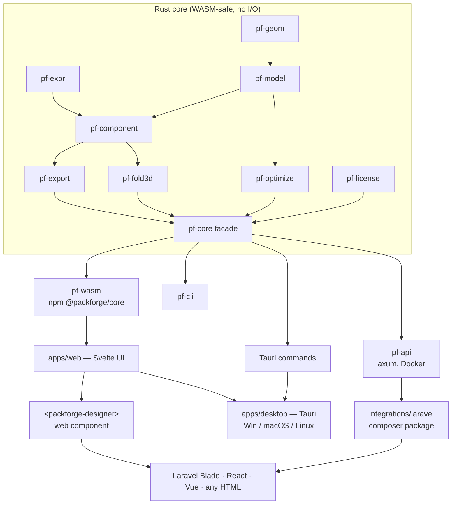

# 02 — Architecture

## 1. Principles

1. **One core, many shells.** All geometry, components, export and optimisation live in pure
   Rust crates with no OS, file, network, or clock access. Every target (web, desktop, server,
   CLI) is a thin shell around the same core.
2. **WASM-safe core.** Core crates must compile to `wasm32-unknown-unknown`. CI enforces it.
3. **One UI.** A single web frontend (TypeScript + Svelte) is used in the browser, inside the
   Tauri desktop app, and as an embeddable web component.
4. **Deterministic.** Same inputs ⇒ identical outputs. No randomness or time in the core.
5. **Data-driven components.** Box styles are data files (see [04-component-format.md](04-component-format.md)),
   not compiled code, so the library grows without releases.

## 2. Repository layout (Cargo + pnpm monorepo)

```
packforge/
├─ crates/
│  ├─ pf-geom/        2D geometry: points, segments (line/arc/cubic), paths, offsets, bbox, transforms
│  ├─ pf-model/       Domain types: LineType, DieLine, Panel, FoldModel, Board, Units, Project
│  ├─ pf-expr/        Safe expression evaluator for component formulas (no I/O, step limit)
│  ├─ pf-component/   Component format parser, validator, evaluator → DieLine + FoldModel
│  ├─ pf-export/      SVG, PDF, DXF, CF2, HPGL writers; post-processor profiles
│  ├─ pf-fold3d/      Fold model → triangle mesh, glTF writer
│  ├─ pf-optimize/    Case sizing, pallet loading, nesting
│  ├─ pf-license/     Ed25519 license token verify (core) — signing lives server-side only
│  ├─ pf-core/        Facade crate: stable public API used by all shells
│  ├─ pf-wasm/        wasm-bindgen bindings → npm package @packforge/core
│  ├─ pf-api/         HTTP server (axum) → Docker image
│  └─ pf-cli/         Command-line tool
├─ apps/
│  ├─ web/            Svelte app (designer UI) — also built as <packforge-designer> web component
│  └─ desktop/        Tauri 2 shell that loads apps/web and calls pf-core natively
├─ library/           Component definitions (*.pfc.toml) + thumbnails, versioned
├─ integrations/
│  └─ laravel/        Composer package packforge/laravel (PHP client for pf-api)
├─ docs/
└─ tests/             Golden-file tests (expected SVG/DXF per component & params)
```

## 3. Layer diagram



## 4. Key technology choices

| Concern | Choice | Why |
|---|---|---|
| Language (core) | Rust stable, edition 2021 | Native speed, WASM target, memory safety |
| 2D curves | `kurbo` | Robust béziers/arcs, offsets, bbox; WASM-friendly |
| Tessellation (3D/raster) | `lyon` | Path → triangles for 3D panels |
| Expressions | own `pf-expr` (small Pratt parser) | Tiny, deterministic, sandboxed, units-aware; avoids a general scripting engine in v1 |
| Serialization | `serde` + `toml` / `serde_json` | Component files (TOML), API (JSON) |
| SVG | own writer | Simple, full control of line-type styling |
| PDF | `krilla` | Pure Rust, vector, WASM-compatible |
| DXF | `dxf` crate (MIT) or own minimal writer | Layers per line type; R12/R2000 ASCII for max compatibility |
| CF2 / HPGL | own writers from public specs | Small text formats |
| 3D export | `gltf-json` | glTF/GLB for web viewers |
| WASM bindings | `wasm-bindgen` + `wasm-pack` | Standard toolchain, TS types |
| UI | Svelte 5 + TypeScript + Vite | Small bundle, compiles to custom elements |
| 2D canvas | SVG rendering of die-line (v1), WebGL later if needed | Crisp, easy hit-testing |
| 3D viewer | three.js | Mature, works in browser and Tauri webview |
| Desktop | Tauri 2 | Small binaries, native menus, file dialogs, auto-update |
| Server | `axum` + `tokio`, Docker | Fast, simple; stateless |
| Licensing | `ed25519-dalek` | Signed offline tokens |
| Storage | Web: localStorage (v1), IndexedDB when projects grow · Desktop: files + SQLite (`rusqlite`) · Server: stateless (DB optional) | Core stays storage-agnostic |
| CI | GitHub Actions: fmt, clippy, test, wasm build, `cargo deny`, golden tests | Quality + license compliance |

## 5. Core data model (summary)

```text
Units        = mm (internal, f64) — conversion only at UI/export edges
LineType     = Cut | Crease | ReverseCrease | Perforation | HalfCut | Bleed | Dimension | Annotation
Entity       = { path: Path, line_type: LineType, layer: Option<String> }
DieLine      = { entities: Vec<Entity>, bbox, blank_size, metadata }
Panel        = { id, outline: Path, normal_side }
Hinge        = { a: PanelId, b: PanelId, axis: Segment, angle_closed_deg }
FoldModel    = { root: PanelId, panels: Vec<Panel>, hinges: Vec<Hinge>, thickness_mm }
Board        = { id, name, caliper_mm, flute: Option<String>, grammage_gsm, price_per_m2 }
Project      = { component_id, component_version, params: Map<String, Value>, board, units, meta }
RenderResult = { dieline: DieLine, fold: FoldModel, stats: Stats, warnings: Vec<Warning> }
```

## 6. Public core API (pf-core)

Same shape in Rust, WASM (TypeScript) and HTTP JSON:

| Function | Input | Output |
|---|---|---|
| `list_components()` | — | catalogue entries |
| `describe(component_id)` | id | parameter schema (for building UI forms) |
| `render(project)` | Project | RenderResult |
| `export(project, format, options)` | Project, `svg|pdf|dxf|cf2|hpgl|gltf` | bytes + mime |
| `pallet_plan(box_dims, pallet, constraints)` | dims | layers, pattern, counts |
| `case_optimize(product_dims, count, constraints)` | dims | ranked box candidates |
| `verify_license(token, now)` | token, time | entitlements |

`now` is passed in by the shell — the core never reads the clock.

## 7. Premium enforcement by target

| Target | Enforcement |
|---|---|
| Desktop | Signed offline license token verified in `pf-license`; features gated in shell + core |
| Web (embedded) | Premium operations (clean PDF, DXF, CF2, full library) call `pf-api` with the site's API key; browser-only mode = Free tier |
| Server API | API key → plan → entitlements; rate limits per plan |

Rationale: anything that runs purely in a browser can be bypassed, so premium value on the
web is delivered server-side. Details: [06-licensing.md](06-licensing.md).
