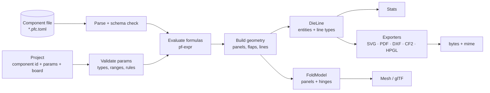
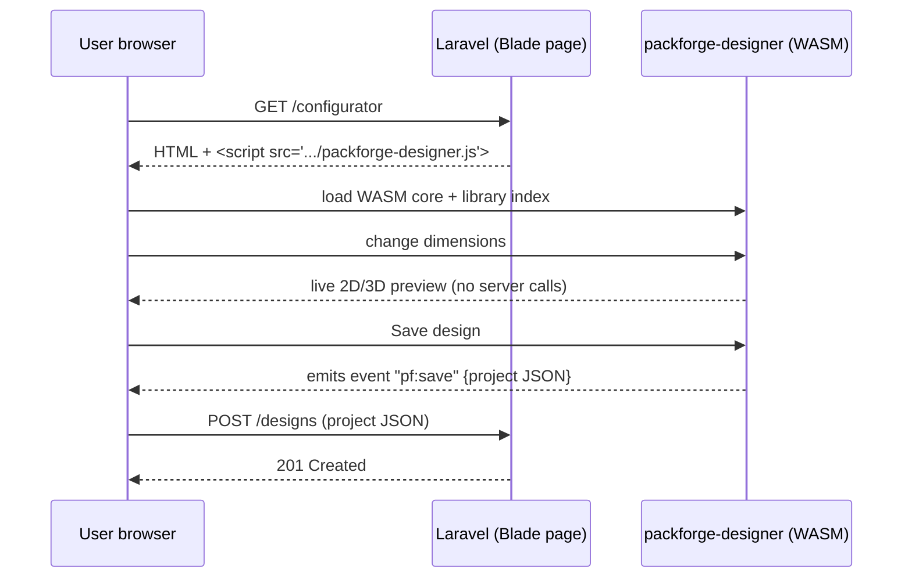
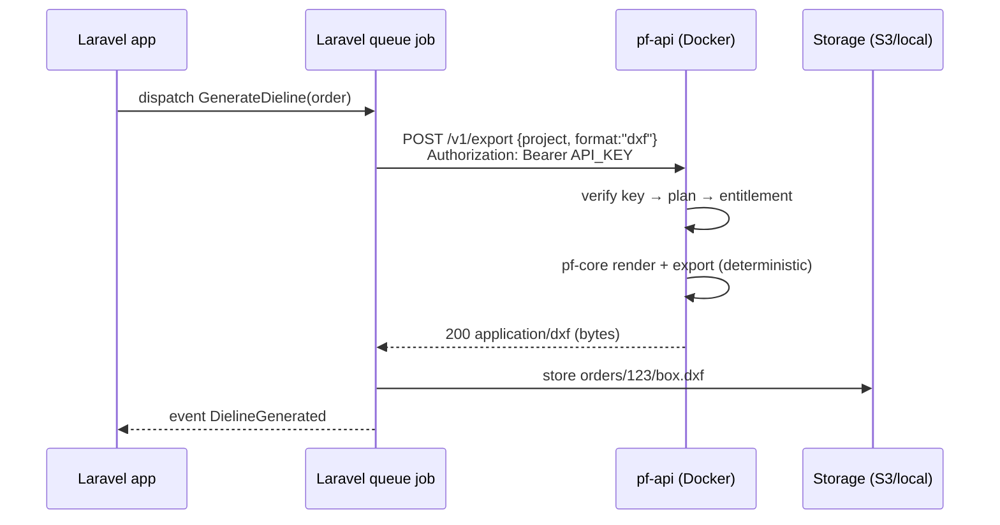
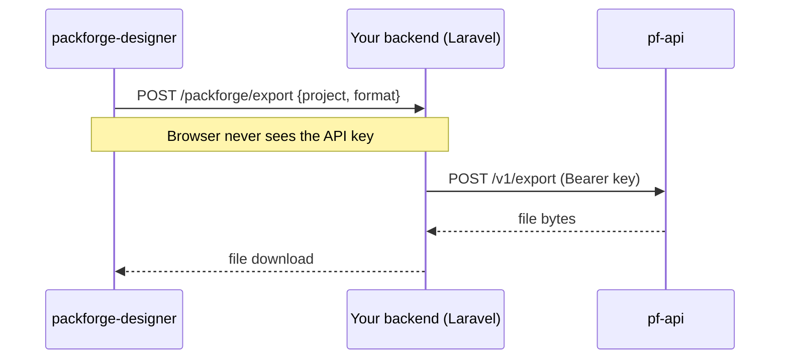
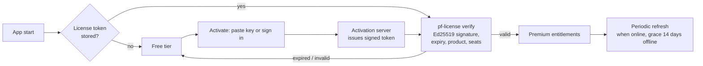
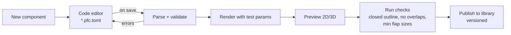

# 03 — Flows

## 1. User flow: design → export

```mermaid
flowchart LR
  A[Open app / page] --> B[Library<br/>browse · search]
  B --> C[Pick style<br/>e.g. FEFCO 0201]
  C --> D[Parameter panel<br/>L × W × H, board, options]
  D -->|every change| E[render&#40;project&#41;<br/>core, &lt;16 ms]
  E --> F[2D die-line view]
  E --> G[3D fold view]
  E --> H[Stats<br/>blank, area, lengths]
  F & G & H --> D
  D --> I{Export}
  I -->|SVG / PDF watermark| J[Free: local]
  I -->|DXF · CF2 · HPGL · clean PDF| K{Entitled?}
  K -->|yes| L[File saved / downloaded]
  K -->|no| M[Upgrade prompt]
```

## 2. Data flow inside the core

## 3. Web embed in Laravel (browser-only, Free tier)

## 4. Server-side export from Laravel (Premium / API)

## 5. Premium operation from embedded designer

## 6. Desktop licensing

## 7. Custom component authoring (Premium)

