# 07 — Implementation Plan

Each stage ends with something **usable and demoable**. Effort sizes are rough
(S ≈ days, M ≈ 1–2 weeks, L ≈ 3–5 weeks of focused work) and will be re-estimated
at the end of every stage.

```mermaid
gantt
  dateFormat  X
  axisFormat  %s
  section Foundation
  S0 Setup & CI                 :s0, 0, 1
  S1 Core + FEFCO 0201          :s1, after s0, 3
  section Platforms
  S2 Web designer (WASM)        :s2, after s1, 3
  S3 API + Laravel + CLI        :s3, after s1, 2
  S4 Desktop (Tauri)            :s4, after s2, 1
  section Product
  S5 Library expansion          :s5, after s2, 4
  S6 3D fold preview            :s6, after s2, 3
  S7 Production exports         :s7, after s3, 3
  S8 Optimisation & reports     :s8, after s7, 3
  section Commercial
  S9 Licensing & plans          :s9, after s4, 2
  S10 Release & distribution    :s10, after s9, 2
```

(Bars are relative units, not dates. S2 and S3 can run in parallel after S1.)

---

## Stage 0 — Project setup (S) — ✅ done (web scaffold moves to Stage 2)

**Goal:** an empty but fully wired monorepo.

- Cargo workspace with all crates from [02-architecture.md](02-architecture.md) as stubs.
- pnpm workspace with `apps/web` (Svelte + Vite + TS).
- `rust-toolchain.toml`, `rustfmt`, `clippy` (deny warnings), `cargo deny` (license allow-list:
  MIT, Apache-2.0, BSD, ISC, Zlib, Unicode).
- GitHub Actions: fmt · clippy · test · `wasm32-unknown-unknown` build of core crates · web build.
- ADR-0001 (stack), ADR-0002 (clean-room), CONTRIBUTING, LICENSE choice.

**Done when:** `cargo test`, `wasm-pack build crates/pf-wasm`, `pnpm build` all pass in CI.

## Stage 1 — Core geometry + first style (M–L) — ✅ code complete, ⏳ physical verification

Status: geometry, model, expression engine, component format, FEFCO 0201, SVG + DXF
export, CLI and golden tests are in place; WASM build passes. Remaining before "stable":
open the DXF in a CAD/CAM tool and fold a 1:1 printed sample. `[[repeat]]` moves to Stage 5.

**Goal:** generate a correct FEFCO 0201 die-line and export it.

- `pf-geom`: Point, Segment (line/arc/cubic via kurbo), Path, transforms, bbox, length.
- `pf-model`: LineType, Entity, DieLine, Board, Project, Stats.
- `pf-expr`: tokenizer, Pratt parser, evaluator, units, functions, errors with spans.
- `pf-component`: TOML parser, schema validation, derived-value ordering (topological),
  rules, panels, lines, `[[repeat]]`.
- `library/fefco/0201.pfc.toml` — full definition.
- `pf-export`: **SVG** (styled by line type) and **DXF** (ASCII, one layer per line type).
- `pf-cli`: `pf render`, `pf export`.
- Golden tests: fixed params → committed `expected.svg` / `expected.dxf`; property tests on
  ranges (outline closed, no NaN).

**Done when:** `pf export fefco-0201 --L 300 --W 200 --H 150 --format dxf` opens correctly in
LibreCAD/AutoCAD and a printed 1:1 sample folds into the right box.

## Stage 2 — Web designer (M–L) — ✅ done

Status: Svelte 5 designer (library with thumbnails, schema-driven parameter form, pan/zoom
die-line viewer with dimensions, line-type legend, stats, units, EN/FR/AR with RTL, light/dark,
save/open/autosave, SVG/DXF export) and the `<packforge-designer>` web component are built and
verified in the browser. Render ≈0.3–1 ms; app WASM 274 KB gz; web component 428 KB gz.
Autosave uses localStorage (small JSON) rather than IndexedDB in v1.

**Goal:** usable in the browser with live preview.

- `pf-wasm`: bindings for `list_components`, `describe`, `render`, `export`; TS types generated.
- `apps/web`: layout (library sidebar · canvas · parameter panel · stats bar), SVG die-line
  viewer with pan/zoom/fit, line-type legend & toggles, unit switch, dark/light theme, i18n
  scaffold (EN/FR/AR + RTL).
- Parameter form generated from the component schema (sliders + inputs, validation messages).
- Save/open project JSON (download + browser autosave).
- Build as `<packforge-designer>` custom element + standalone app.
- Performance budget check: render < 16 ms while dragging; WASM < 3 MB gz.

**Done when:** the designer runs from a static host and can be dropped into a plain HTML page.

## Stage 3 — API, Laravel package, CLI polish (M) — ✅ done (Docker image built in CI only)

Status: `pf-api` (axum) with hashed API keys, per-key rate limits, problem+json errors, ETags,
CORS, body limits and an OpenAPI 3.1 document; Dockerfile (distroless, non-root);
`packforge/laravel` (client, facade, builder, DTOs, exceptions, Blade component, export proxy);
example shop in `examples/laravel-shop` with a queued DXF/SVG job, verified end to end against
a live `pf-api`. Not done: `pf batch` (moved to Stage 7), building the image locally (no Docker
on the dev machine — CI builds and smoke-tests it).

**Goal:** server-side generation from Laravel.

- `pf-api` (axum): `/health`, `/components`, `/components/{id}`, `/render`, `/export`;
  problem+json errors; API-key middleware (file-based keys in v1); rate limiting; OpenAPI.
- Dockerfile (distroless), `docker compose` example with a Laravel app.
- `integrations/laravel`: client, Facade, config, DTOs, exceptions, Blade component,
  export proxy route, tests with `Http::fake()`.
- `pf batch` for CSV input.

**Done when:** a sample Laravel app generates and stores a DXF per order via a queued job,
and embeds the designer with `<x-packforge-designer>`.

## Stage 4 — Desktop app (S–M) — ✅ done (macOS built locally; Windows/Linux installers via CI)

Status: Tauri 2 shell (`apps/desktop`) around the web designer, with native open/save/save-as
dialogs, `.pfproj` file association, recent files, a native menu with shortcuts, drag-and-drop,
unsaved-changes prompt on close, window title with the document name, and native exports through
`pf-core`. `.github/workflows/desktop.yml` builds unsigned installers for all three OSes.
Code signing and auto-update move to Stage 10.

- Tauri 2 shell loading `apps/web`; native file open/save, recent files, menus, drag-drop.
- Use native `pf-core` via Tauri commands for heavy exports; WASM for live preview.
- Builds: `.msi`/`.exe` (Windows), `.dmg` (macOS universal), `.AppImage`/`.deb` (Linux).

**Done when:** installers produced by CI for all three OSes open and export a design.

## Stage 5 — Library expansion (L, ongoing) — 🟡 first batch done (9 styles)

Status: rounded corners and arcs in the component format; outline self-crossing check; library-
wide tests (every style at defaults and across parameter extremes on three boards: no notes,
hinges on creases, connected panels, blank formulas). Styles: FEFCO 0200, 0201, 0202, 0203, 0204,
sleeve, glued-corner tray, straight and reverse tuck end cartons. Still to do from the list below:
0215, 0300/0310 telescope boxes, 0409, 0421/0427 die-cut mailers, crash-lock bottom, board presets
for more grades, and physical sample verification of each style. The full ordered list is in
[08-style-roadmap.md](08-style-roadmap.md).

- Priority styles: FEFCO 0200, 0201, 0202, 0203, 0204, 0215, 0300, 0310, 0320, 0409, 0421,
  0427; ECMA A20.20.03.01 (reverse tuck end), straight tuck end, crash-lock bottom, sleeve, tray.
- Arc/bezier support in the component format for locks and thumb-holes.
- Board presets (single wall B/C/E, double wall BC/EB, folding boxboard calipers).
- Thumbnail generation via CLI; library search & categories in UI.
- Every style: golden tests + physical sample verification checklist.

## Stage 6 — 3D fold preview (M–L)

- `pf-fold3d`: panel graph → transforms by hinge angle; board thickness; mesh via lyon.
- three.js viewer in web UI; fold slider 0–100 %; orbit/zoom; PNG snapshot.
- glTF/GLB export (premium); OBJ/STL.

## Stage 7 — Production exports (M–L)

- PDF (krilla): 1:1 scale, title block, dimensions, legend; watermark in Free.
- CF2 and HPGL writers from public specs; post-processor profiles (line type → tool/pen,
  origin, rotation, units, layer names) as TOML presets; profile editor in UI.
- Nesting v1: rectangular bounding-box nesting on a sheet with gaps; true-shape later.
- Verification against at least one real cutting table / CAM import.

## Stage 8 — Optimisation & reports (M–L)

- Pallet loading: EUR/US/ISO pallets, max height/weight, layer patterns (block, interlocked,
  pinwheel), overhang rules; 3D layer view.
- Case optimisation: product arrangement inside a case, ranked by board area/pallet efficiency.
- Cost estimate from board price and blank area.
- Reports: HTML → PDF with branding; API endpoints `/pallet`, `/case-optimize`.

## Stage 9 — Licensing & plans (M)

- `pf-license` verify; activation service (small axum app + SQLite/Postgres) issuing tokens.
- Entitlement gating in UI/core/API; upgrade prompts; API key plans and quotas.
- Payment provider integration (Paddle/Stripe) — can be deferred.

## Stage 10 — Release & distribution (M)

- Code signing: Windows (EV/OV cert), macOS notarisation, Linux signatures.
- Tauri auto-updater; npm publish `@packforge/core` + `@packforge/designer`;
  Packagist `packforge/laravel`; Docker Hub/GHCR `packforge/api`.
- Docs site, examples, changelog, telemetry opt-in (crash reports only).

---

## Cross-cutting (every stage)

| Practice | Detail |
|---|---|
| Testing | Unit + golden-file + property tests in core; Playwright for web UI; Pest/PHPUnit for Laravel |
| Accuracy | Physical sample checklist per style before marking it "stable" |
| Clean room | PR template checkbox: "No competitor code/assets used" ([00](00-clean-room-policy.md)) |
| Docs | Update the relevant doc in the same PR; ADR for any architectural decision |
| Performance | Benchmarks (`criterion`) for render/export in CI with regression alerts |

## Decisions needed from the product owner

1. Project/brand name (working name: PackForge) and repository host (GitHub private?).
2. Open-source core or fully proprietary? (Affects licensing of the npm/composer packages.)
3. UI framework confirmation: Svelte (recommended) vs React (larger ecosystem, team familiarity?).
4. First target market & languages (Arabic/RTL priority?).
5. Hosted API (SaaS) vs self-hosted only for Enterprise.
6. Access to a cutting table / sample-making for physical verification.
